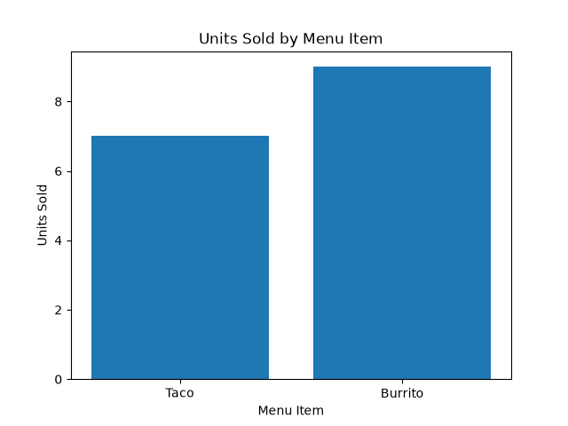
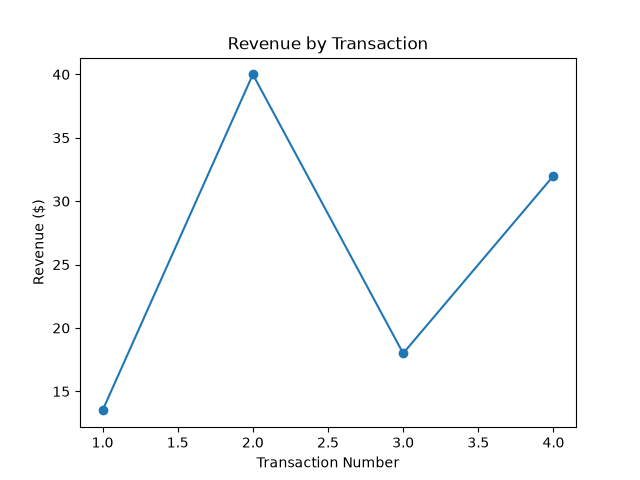
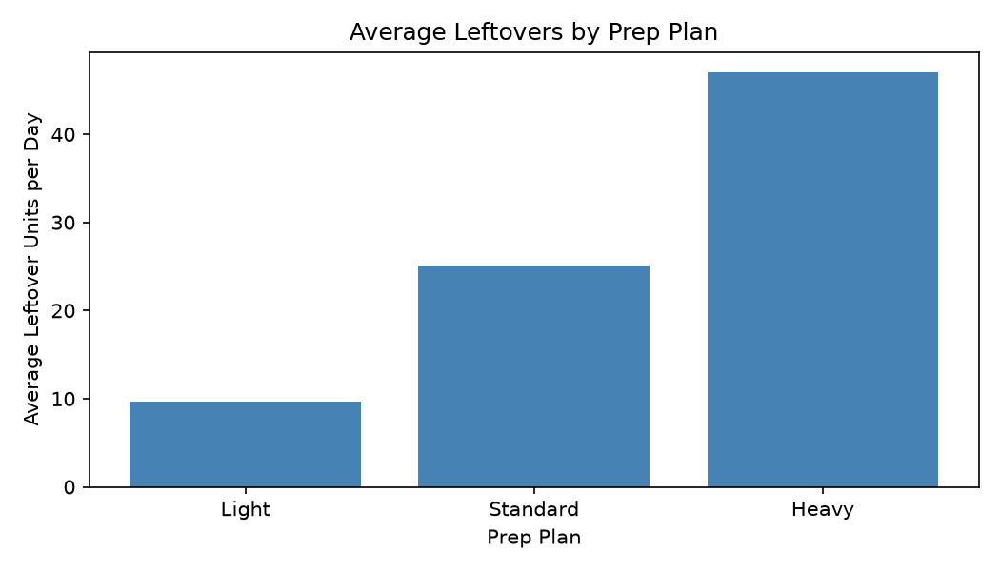

# Big Sky Bites — Food Truck Management Application

## Business Problem
Big Sky Bites is a food truck that needs a simple way to manage food inventory, update prices and quantities, and track customer purchases. This application helps organize inventory and sales information in one place while reducing the need for manual recordkeeping.

## Business Question
How can Big Sky Bites track its available inventory and maintain accurate records of customer sales?

## How to Run
1. Open the `Food_truck_app` folder in Visual Studio Code.
2. Open the terminal and run `python main.py`.
3. Choose an option from the main menu by entering a number from 1–7.
4. Follow the prompts to view inventory, update inventory, or record a sale.
5. Select Option 7 to save changes and exit the application.

## Menu Options
1. **View Menu and Inventory** — Displays available food items, prices, and quantities.
2. **Update Inventory** — Allows the user to add new food items or change existing prices and quantities.
3. **Record a Sale** — Records customer purchases, calculates totals, and reduces inventory quantities.
4. **View Sales Report** — Displays sales totals, revenue, average transaction value, and best-selling items.
5. **Run Sales Simulation** — Compares three daily prep plans, recommends one, and saves a chart.
6. **Generate Charts** — Creates charts showing units sold by menu item and revenue by transaction.
7. **Save and Exit** — Saves inventory and sales transactions to their CSV files and closes the application.

## Files

- `main.py` — Runs the main menu and connects the application's functions.
- `big_sky_bites.py` — Manages inventory, records sales, and handles CSV file storage.
- `reports.py` — Generates sales reports and charts.
- `inventory.csv` — Stores food item names, prices, and available quantities.
- `sales.csv` — Stores recorded sales transactions.
- `units_sold_by_item.png` — Bar chart showing how many units of each menu item were sold.
- `revenue_by_transaction.png` — Line chart showing revenue generated by each transaction.
- `simulation.py` — Simulates daily demand and compares food prep plans.
- `simulation_results.png` — Shows the average daily leftovers for each prep plan.

## Charts

### Units Sold by Menu Item

This bar chart compares the number of units sold for each menu item, helping Big Sky Bites identify its most popular products.

### Revenue by Transaction

This line chart shows the revenue generated by each recorded transaction, helping Big Sky Bites compare individual sale amounts.

## Simulation

How much food should Big Sky Bites prepare each day to meet customer demand while minimizing leftovers?

The program randomly generates daily demand for each menu item. It simulates 1,000 days for each of three prep plans: Light, Standard, and Heavy. It measures average leftovers and average missed units per day.

**Recommendation.** Use the Standard prep plan. Light leaves the least food but exceeds the target of five missed units per day. Standard meets the target and leaves less food than Heavy.

**Assumption.** Each menu item uses the same demand range every day. Actual demand may vary on weekends or during events.

## Author
Asher Deming